# Session 13: Kubernetes Storage, HPA & Probes

**Student:** Prabhav Semwal · **Enrollment:** 24BCS10358


The lab uses an isolated `coursework-s13` namespace and exercises temporary volumes, node storage, persistent claims, dynamic provisioning, CPU autoscaling, and a notes application with all three health probes.

```bash
kubectl create namespace coursework-s13
kubectl -n coursework-s13 apply -f 01-kubernetes-volumes/emptydir-demo.yaml
kubectl -n coursework-s13 apply -f 02-hpa/hpa.yml
kubectl -n coursework-s13 apply -f 02-hpa/load-generator.yaml
kubectl -n coursework-s13 apply -f 03-mini-project/app.yaml
```

## Volumes

See [volume notes](01-kubernetes-volumes/README.md) and the accompanying manifests. The runner writes distinct markers, replaces Pods, checks which data survives, and verifies the dynamic provisioner's reclaim policy.

## HPA

[hpa.yml](02-hpa/hpa.yml) deploys a CPU-consuming HTTP service with a 100m CPU request and a 30% utilization target. [The load generator](02-hpa/load-generator.yaml) makes concurrent requests. Metrics Server must report resource metrics before HPA can calculate utilization.

```bash
kubectl -n coursework-s13 get hpa
kubectl -n coursework-s13 get pods
kubectl -n coursework-s13 top pods
kubectl -n coursework-s13 describe hpa cpu-demo
```

The runner waits for measured scale-out, removes the load, and waits for scale-in. Scaling is bounded between one and four replicas. Utilization is CPU usage divided by CPU requests; it is not a percentage of the whole node's capacity.

## Mini project and probes

[The notes application](03-mini-project/app.yaml) uses a PVC, Deployment, Service, HPA, startup probe, readiness probe and liveness probe. The runner writes a marker, deletes the Pod, and verifies the marker survives. It makes readiness fail by temporarily removing the index file, observes the Pod leave ready endpoints, restores the file, and checks recovery.

Startup probes delay liveness/readiness evaluation until initialization succeeds. Readiness controls whether the Pod serves Service traffic. Liveness restarts an unhealthy container. A failed readiness check alone does not restart it.

[Kubernetes storage](https://kubernetes.io/docs/concepts/storage/volumes/) · [HPA](https://kubernetes.io/docs/tasks/run-application/horizontal-pod-autoscale/) · [Probes](https://kubernetes.io/docs/tasks/configure-pod-container/configure-liveness-readiness-startup-probes/)

The mini-project uses two initial replicas, a 500Mi PVC mounted at `/data`, and HPA bounds of two to five replicas with a 50% CPU target. Recreate avoids overlapping rollout generations when sharing the single-node ReadWriteOnce volume.

## Recorded execution evidence

These PNGs render the saved output of real commands. Each image links to its complete transcript.

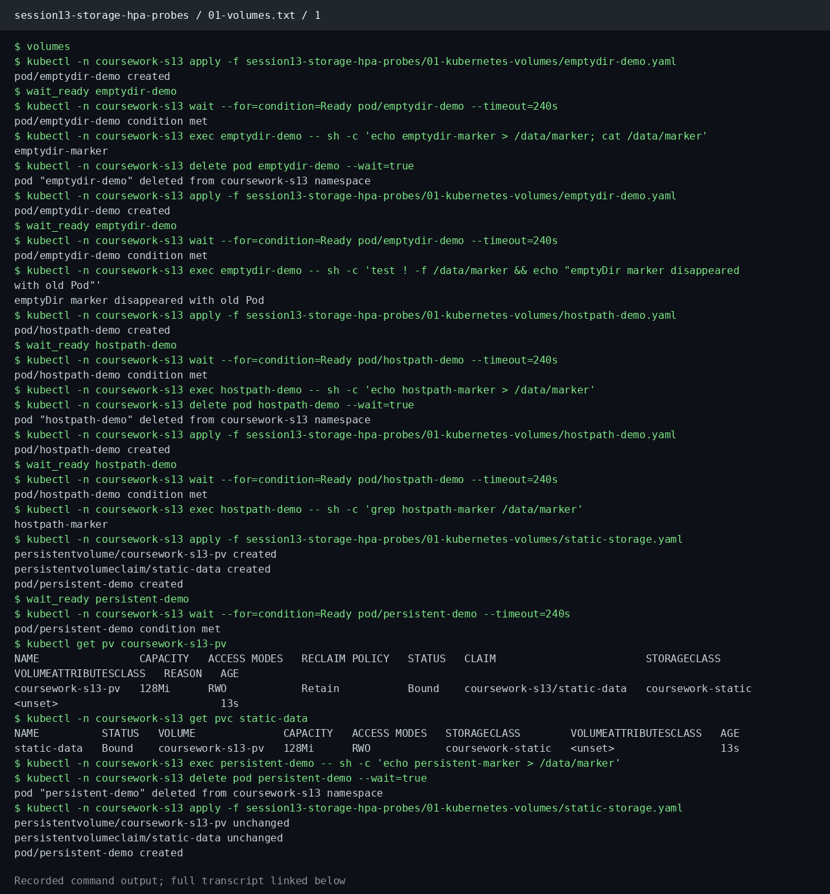

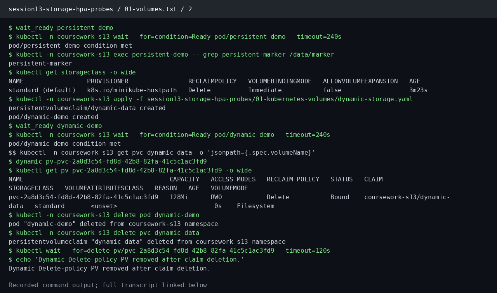

[Complete commands and output: 01-volumes.txt](evidence/01-volumes.txt)

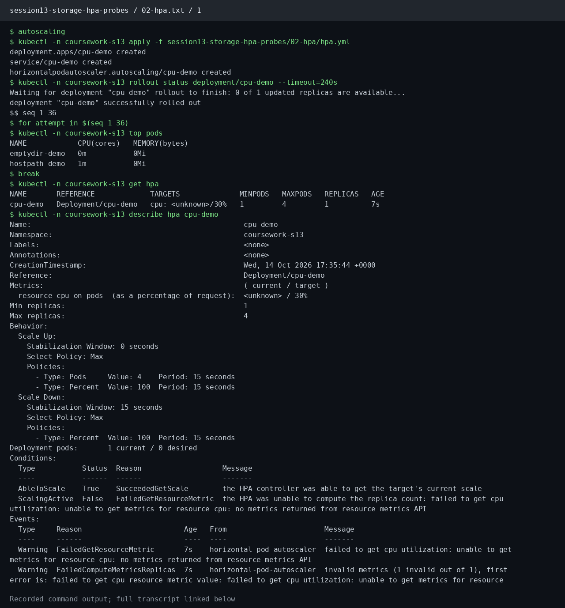

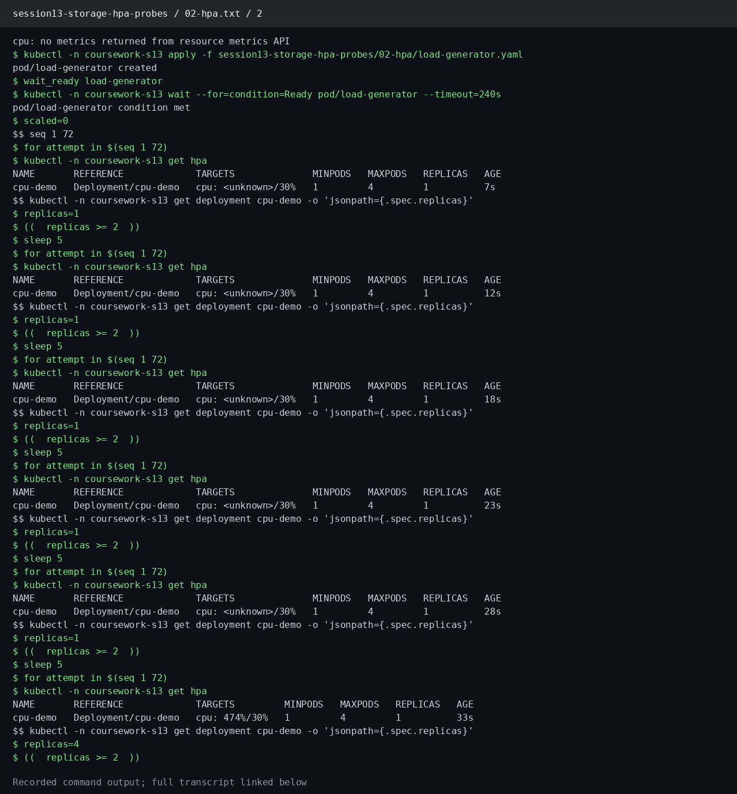

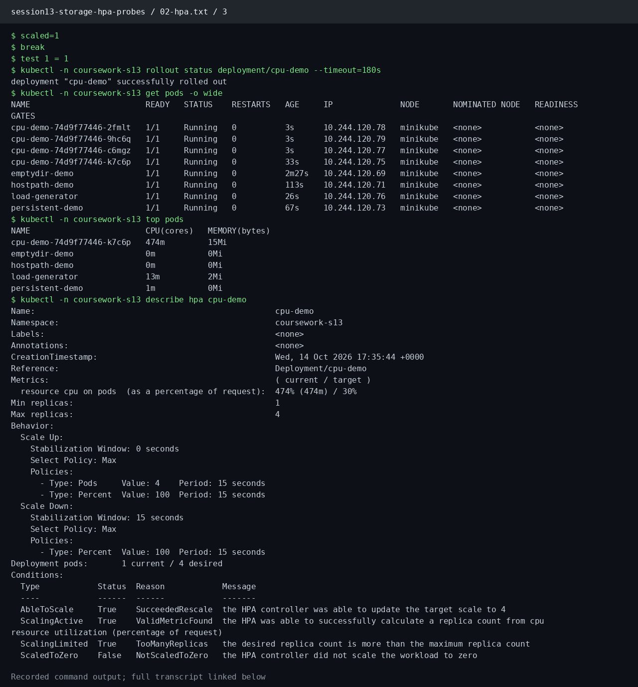

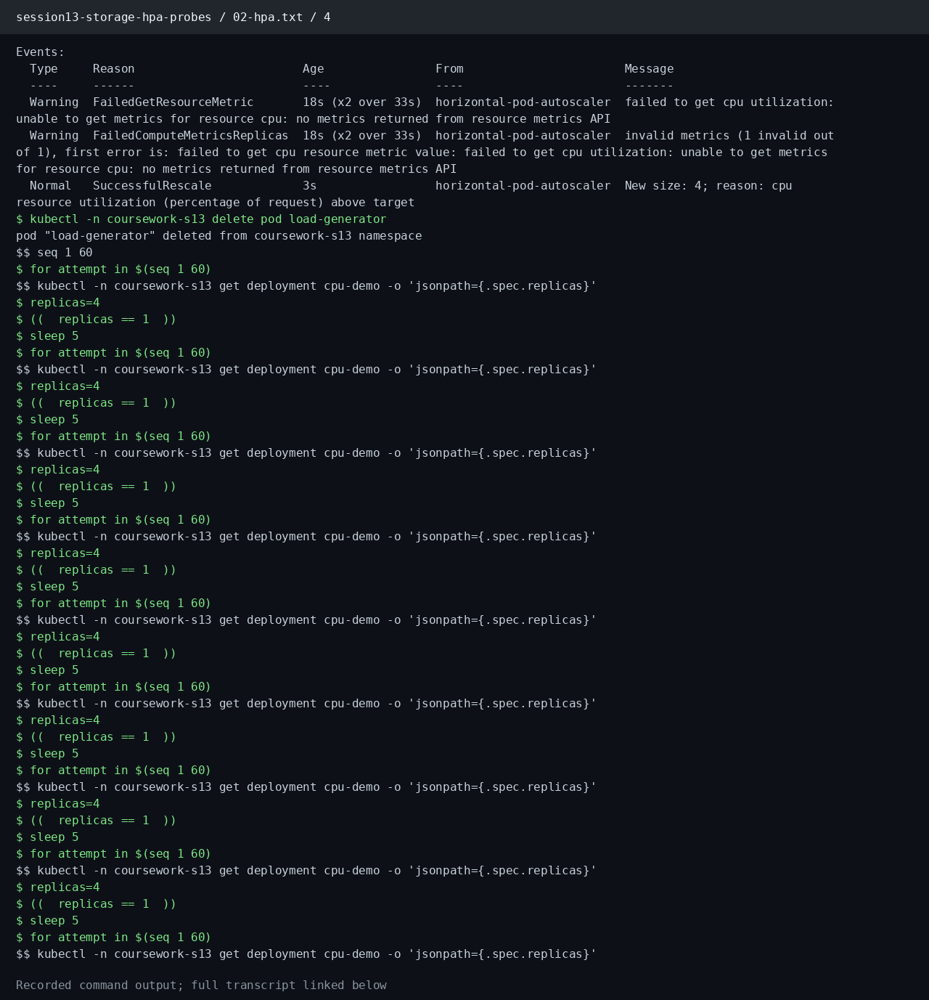

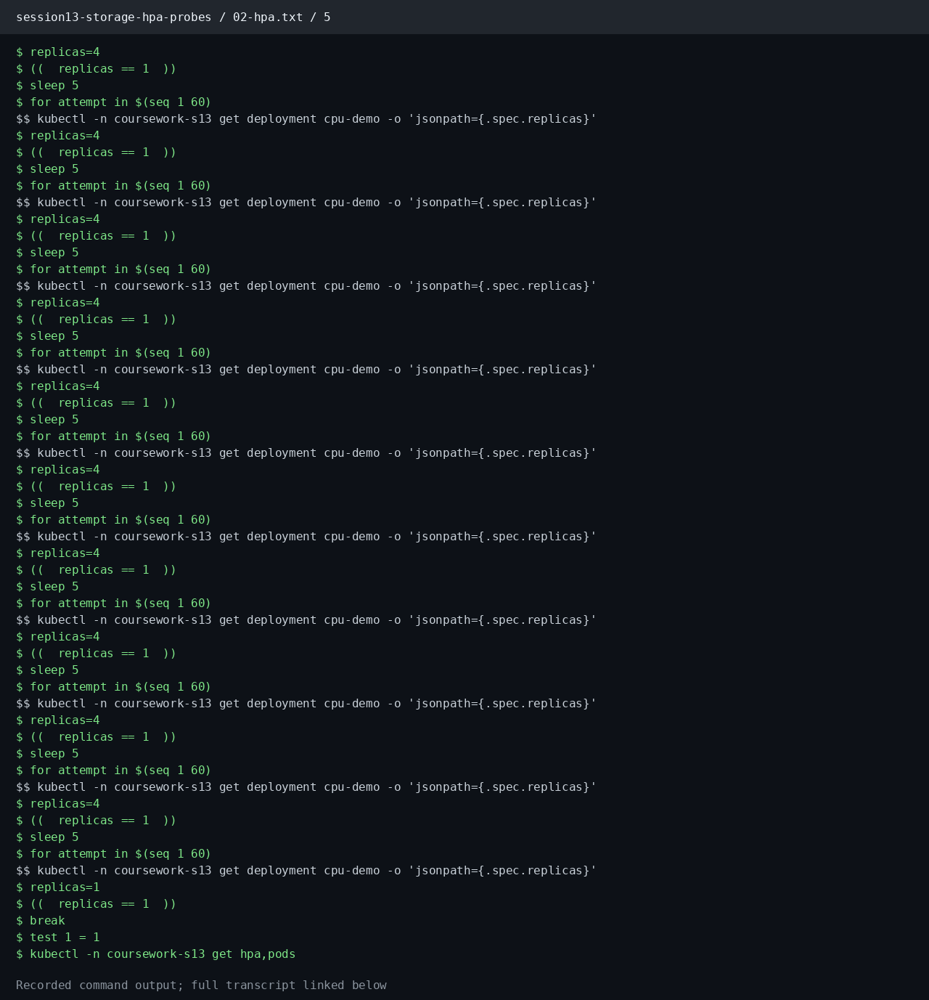

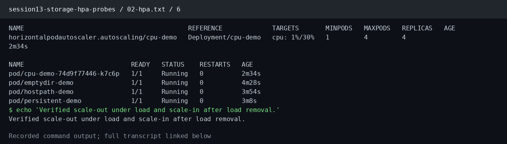

[Complete commands and output: 02-hpa.txt](evidence/02-hpa.txt)

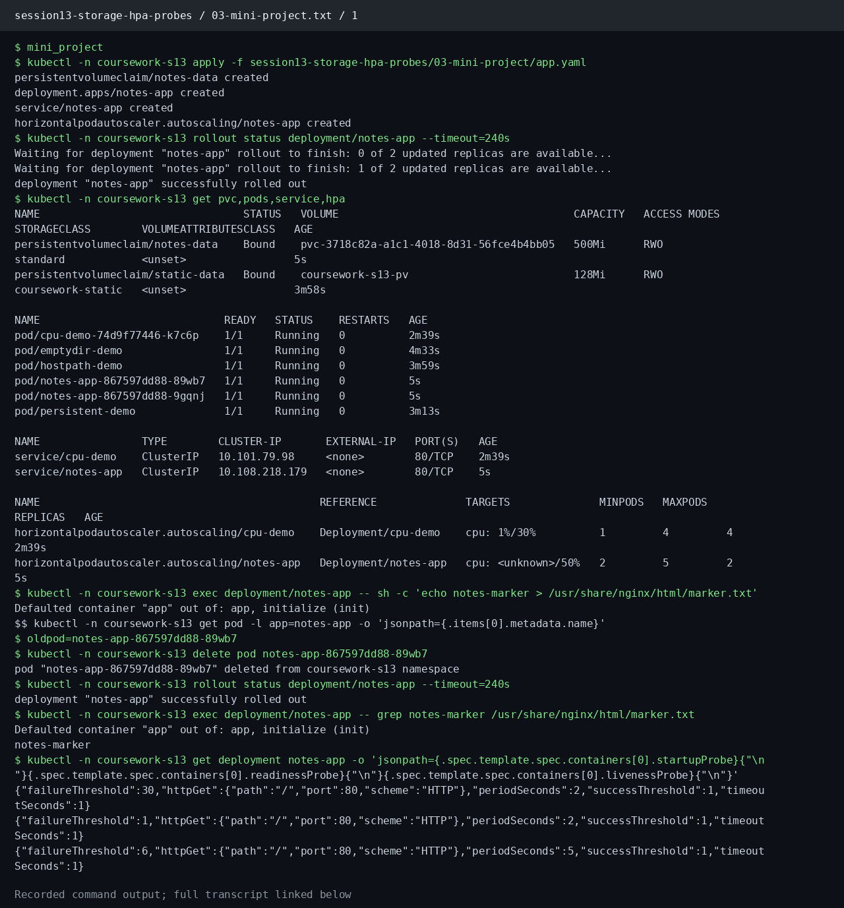

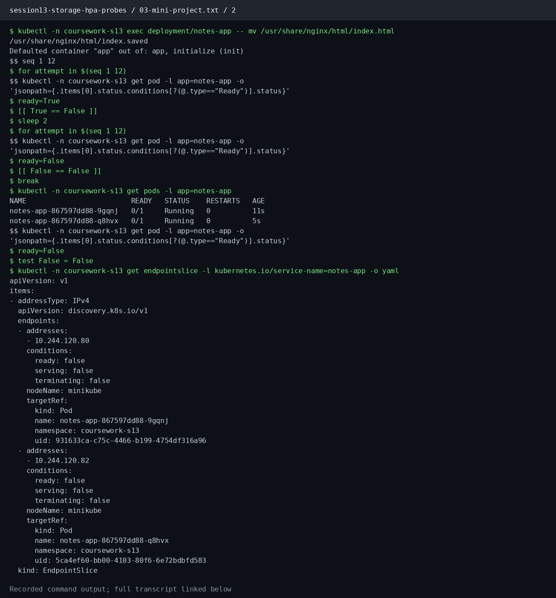

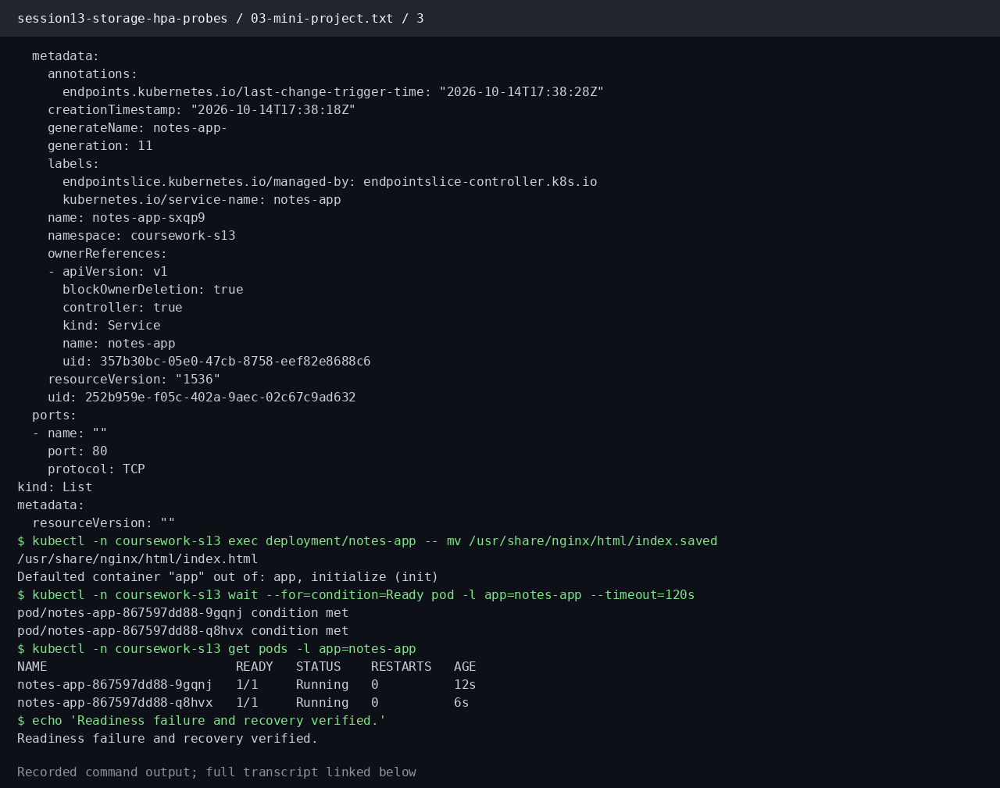

[Complete commands and output: 03-mini-project.txt](evidence/03-mini-project.txt)

[Recorded lab execution](https://github.com/Yeashu/DevOps-Coursework/actions/runs/38607298163/job/116001343399)
