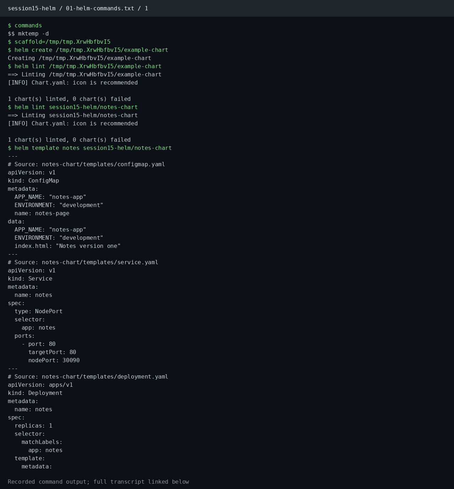
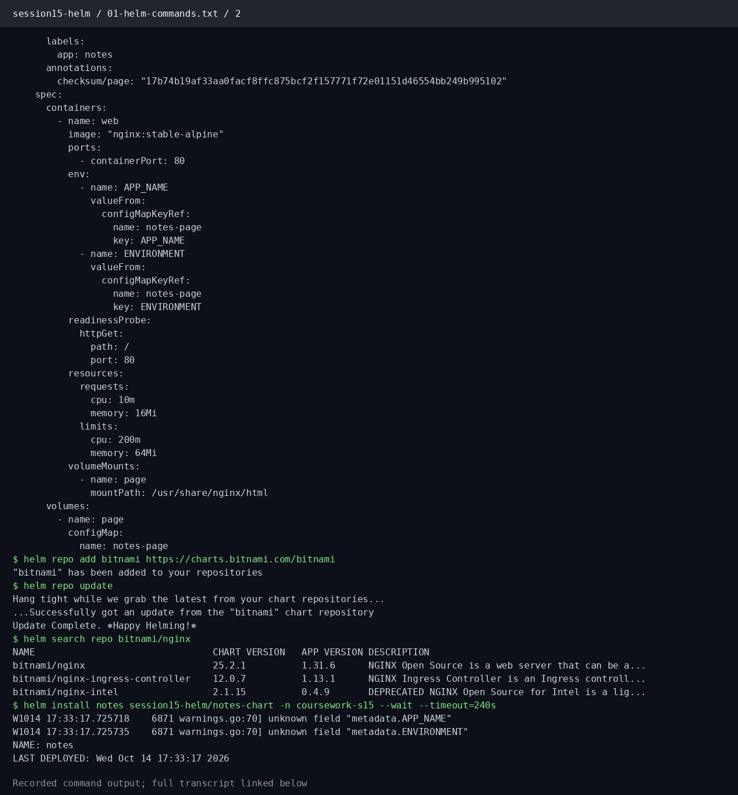
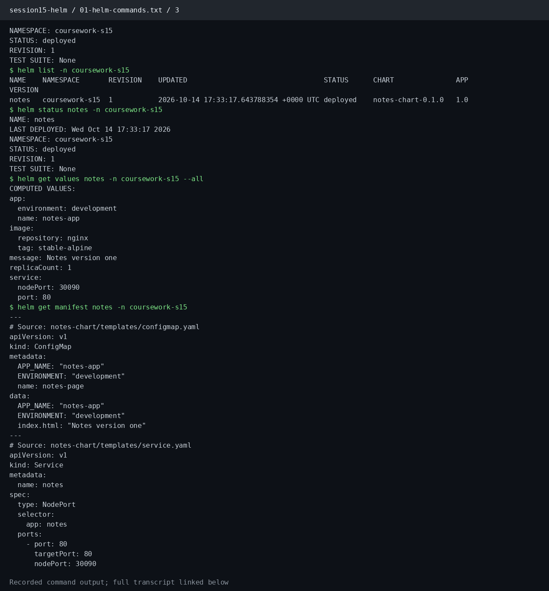
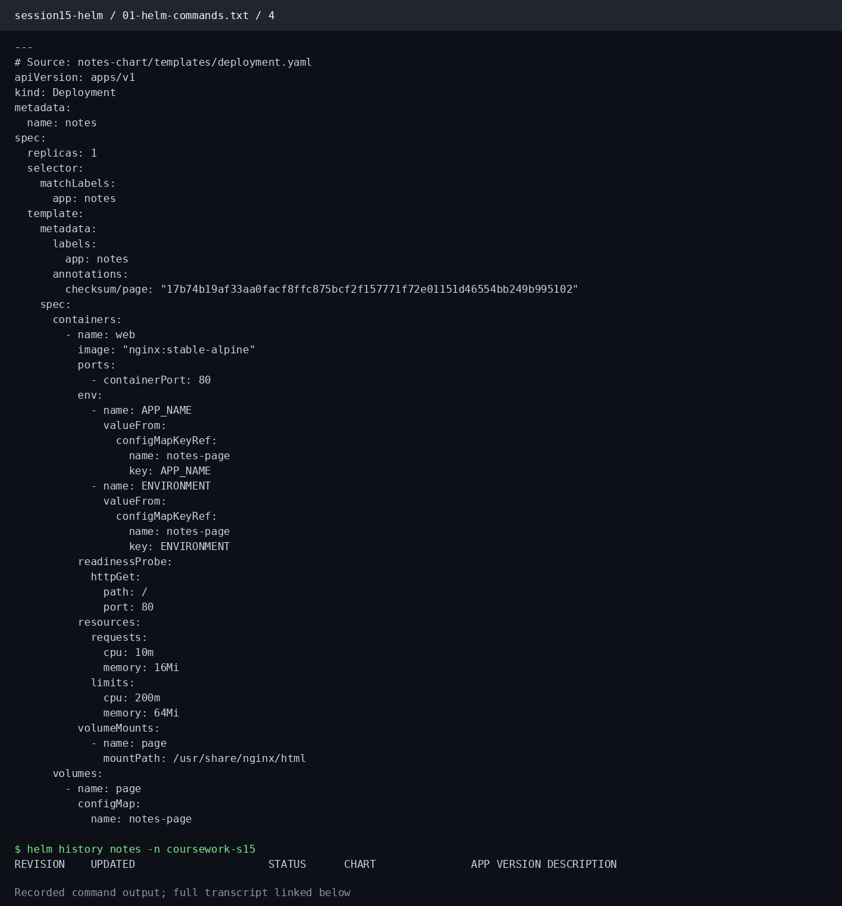
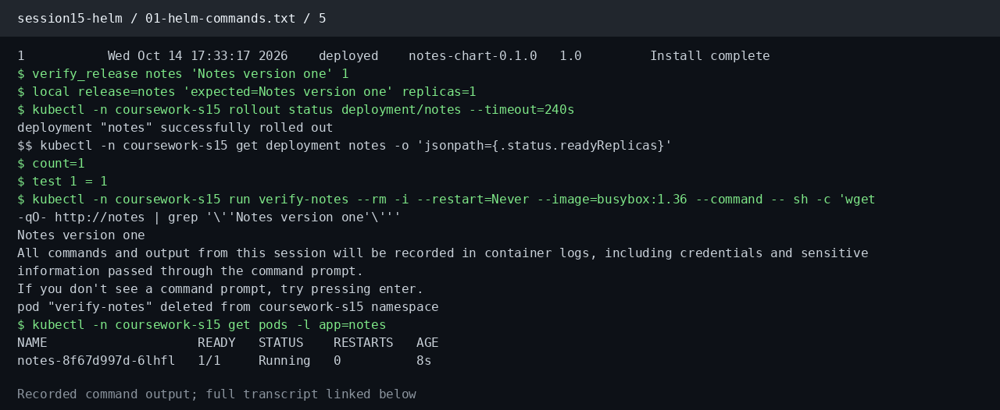
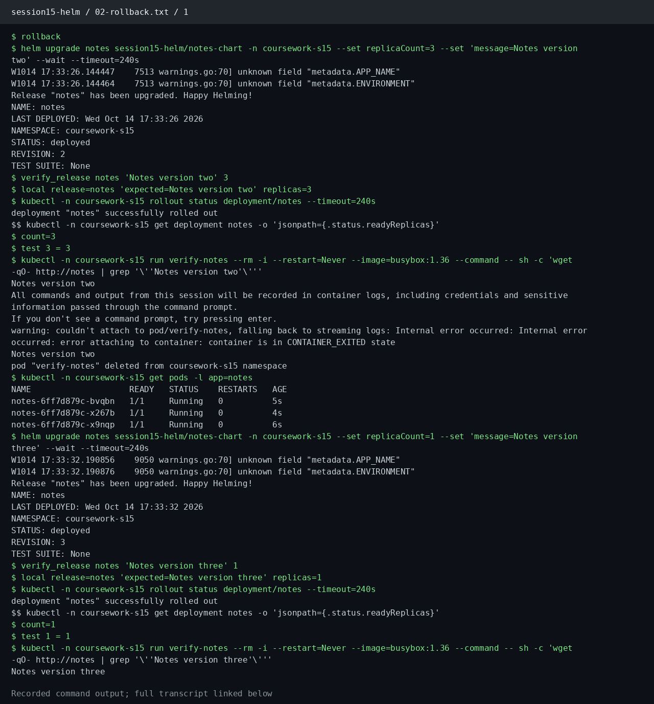
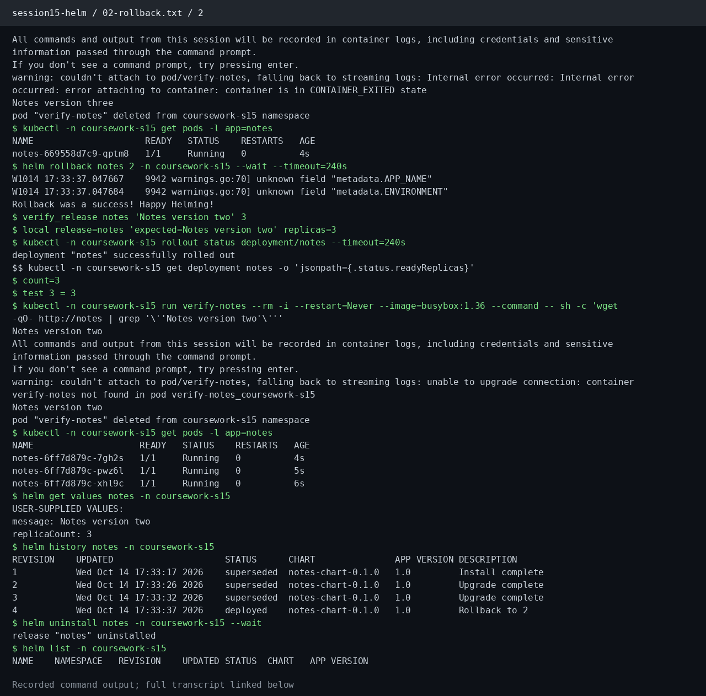
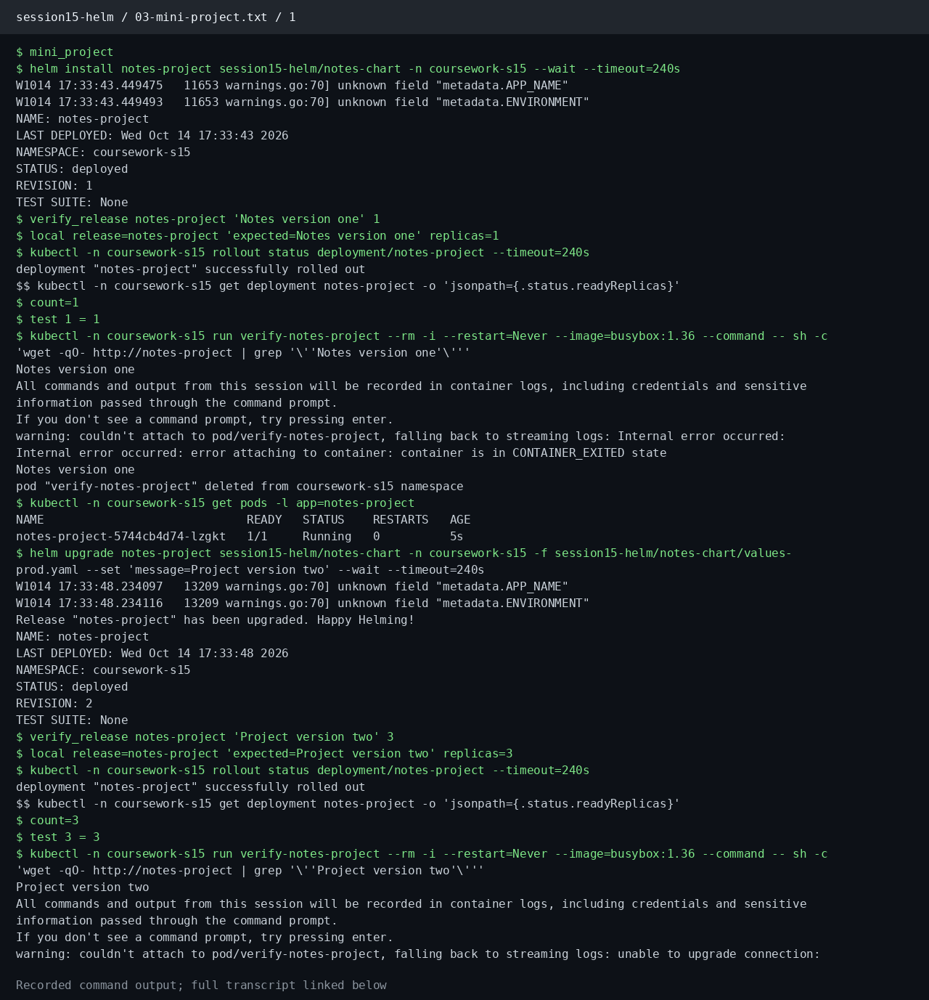
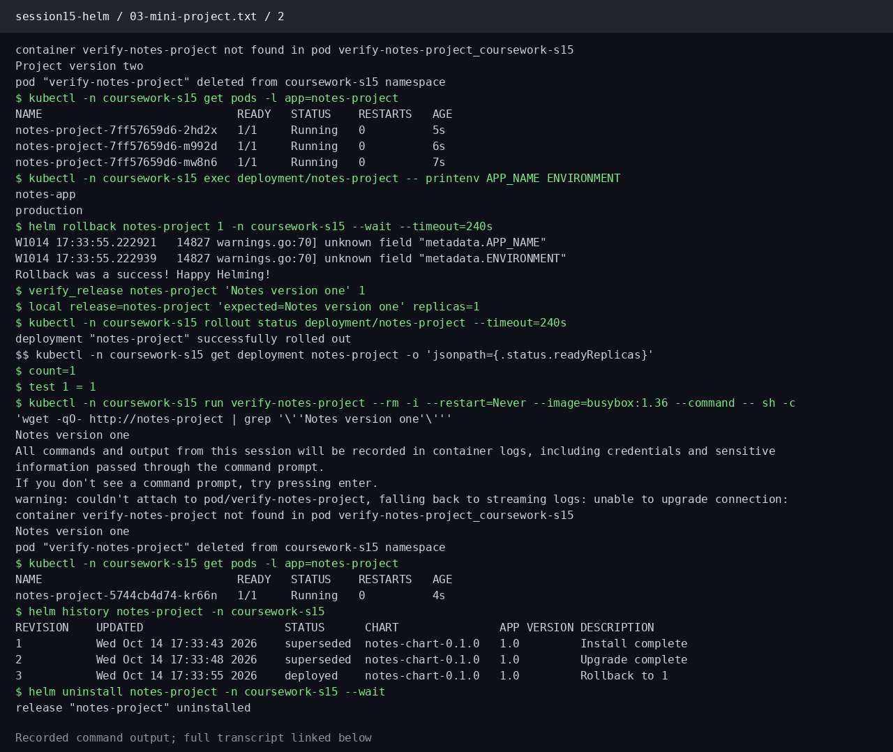

# Session 15: Helm

**Student:** Prabhav Semwal · **Enrollment:** 24BCS10358


[notes-chart](notes-chart/) contains `Chart.yaml`, [values.yaml](notes-chart/values.yaml), and [templates](notes-chart/templates/). Values control the replica count, container image, and served message. A checksum annotation triggers a rollout when page content changes.

```bash
helm install notes ./notes-chart --namespace coursework-s15 --create-namespace --wait
helm upgrade notes ./notes-chart -n coursework-s15 --set replicaCount=3 --set "message=Notes version two" --wait
helm history notes -n coursework-s15
helm rollback notes 1 -n coursework-s15 --wait
```

## Commands

| Command | Purpose |
| --- | --- |
| helm create | Generate a chart scaffold |
| helm lint, helm template | Validate and inspect rendered Kubernetes resources |
| helm install | Create a named release |
| helm list, helm status | Inspect installed releases and current status |
| helm get values, helm get manifest | Read release inputs and rendered resources |
| helm upgrade | Apply a new chart or values as a new revision |
| helm history | Inspect release revisions |
| helm rollback | Restore the resources and values of an earlier revision |
| helm repo add, repo update | Register and refresh a chart repository |
| helm search repo | Search the repository index |
| helm uninstall | Remove release resources |

## Rollback workflow and mini project

The runner installs revision 1 with one replica and version-one content, upgrades to revision 2 with three replicas and version-two content, upgrades again to revision 3 with one replica, then rolls back to revision 2. It waits for rollouts and verifies the HTTP response and replica count after each change. Helm creates a new revision for a rollback; the prior revision remains in history.

The notes chart is also installed as a separate mini-project release, upgraded, rolled back and uninstalled. All commands and observations are saved by the runner.

[Helm commands](https://helm.sh/docs/helm/) · [Chart guide](https://helm.sh/docs/topics/charts/)

[Production values](notes-chart/values-prod.yaml) use three replicas and inject the production environment through the chart ConfigMap. The mini-project upgrade uses this values file before rolling back to the development revision.

## Recorded execution evidence

These PNGs render the saved output of real commands. Each image links to its complete transcript.











[Complete commands and output: 01-helm-commands.txt](evidence/01-helm-commands.txt)





[Complete commands and output: 02-rollback.txt](evidence/02-rollback.txt)





[Complete commands and output: 03-mini-project.txt](evidence/03-mini-project.txt)

[Recorded lab execution](https://github.com/Yeashu/DevOps-Coursework/actions/runs/38607298163/job/116001343313)
