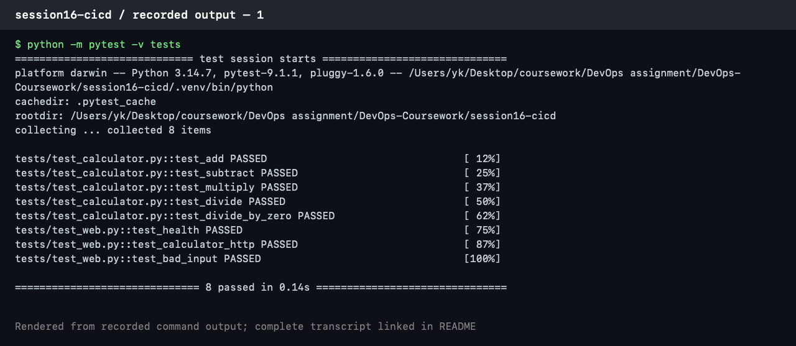

# Session 16: CI/CD & GitHub Actions

**Student:** Prabhav Semwal · **Enrollment:** 24BCS10358

The submission for this assignment is maintained in the standalone **Hello-CICD** repository:

- [Complete Session 16 README](https://github.com/Yeashu/Hello-CICD/blob/main/session16/README.md)
- [Application, tests and Dockerfile](https://github.com/Yeashu/Hello-CICD)
- [CI/CD and DevSecOps workflow](https://github.com/Yeashu/Hello-CICD/blob/main/.github/workflows/devsecops.yml)
- [Pipeline runs and execution evidence](https://github.com/Yeashu/Hello-CICD/actions)

The README covers CI and CD, workflows, jobs, steps, runners, secrets, artifacts, builds, tests and deployment. The workflow records its actual output and generates screenshots for both CI/CD assignments. Push the standalone repository to execute it.

## Local calculator exercise

The calculator files in this folder can also be built and tested from the coursework repository:

```bash
cd session16-cicd
python3 -m venv .venv
source .venv/bin/activate
pip install -r requirements-dev.txt
python -m pytest -v --cov=app
bash build.sh
docker build -t coursework-calculator .
docker run --rm -p 5001:5001 coursework-calculator
```

## Recorded execution evidence

This PNG renders genuine saved local unit-test output.



[Complete command output](evidence/local-unit-tests.txt)
