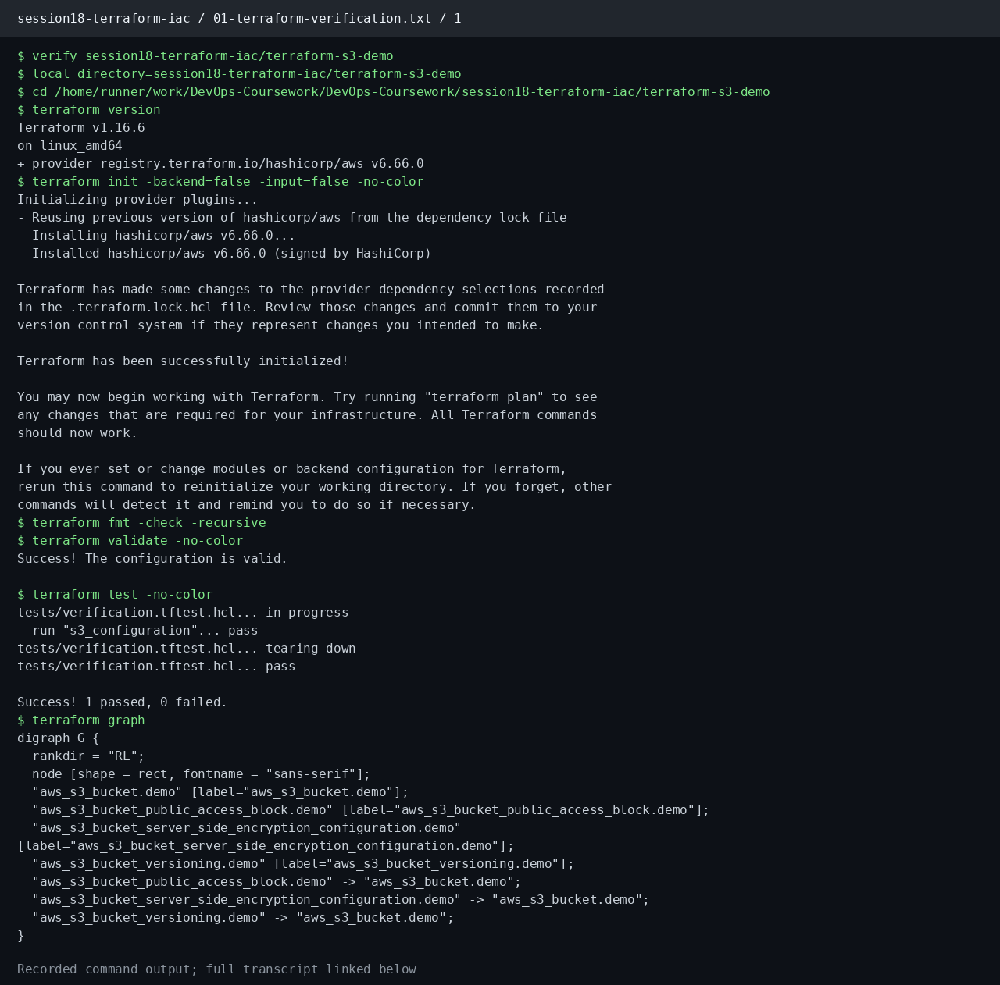

# Session 18: Terraform & Infrastructure as Code

**Student:** Prabhav Semwal · **Enrollment:** 24BCS10358


The [Terraform S3 configuration](terraform-s3-demo/README.md) defines a bucket, versioning, encryption, and public-access blocking. This exercise verifies formatting, provider schemas and resource configuration, and runs a mock-provider plan test.

```bash
cd terraform-s3-demo
terraform init -backend=false -input=false
terraform fmt -check -recursive
terraform validate
terraform test
terraform graph
```

`terraform init -backend=false` downloads the provider without configuring a remote state backend. `terraform fmt -check` checks formatting; `terraform validate` verifies syntax and provider schema. `terraform test` uses Terraform's mock AWS provider to verify the planned resource configuration without creating cloud resources. `terraform graph` exposes the resource dependency edges.

The mock plan establishes configuration behavior, not cloud resource existence. The saved command output and screenshots show the verification that was actually run.

[Terraform CLI](https://developer.hashicorp.com/terraform/cli) · [Mock providers](https://developer.hashicorp.com/terraform/language/tests/mocking)

## Recorded execution evidence

These PNGs render the saved output of real commands. Each image links to its complete transcript.



[Complete commands and output: 01-terraform-verification.txt](evidence/01-terraform-verification.txt)

[Recorded lab execution](https://github.com/Yeashu/DevOps-Coursework/actions/runs/38607298163/job/116001343320)
