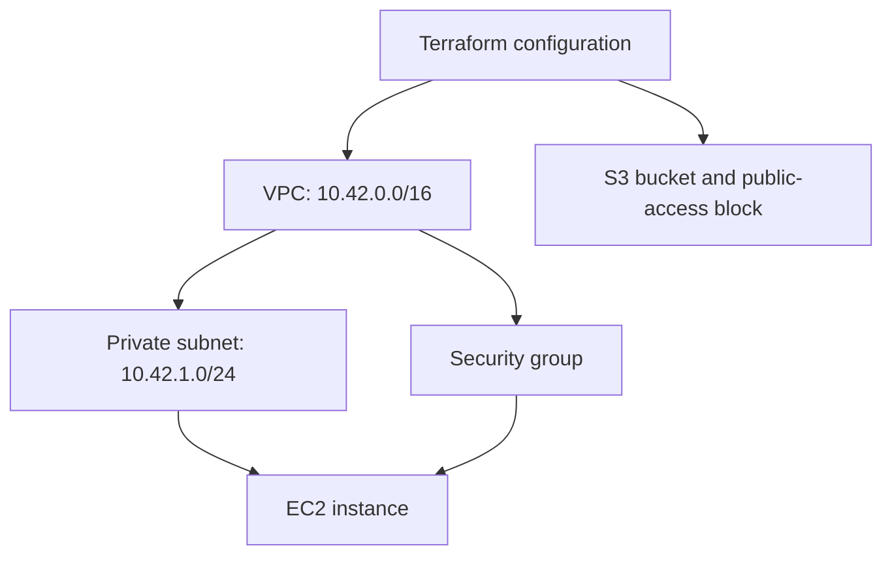

# Session 19: Cloud & Terraform in Action

**Student:** Prabhav Semwal · **Enrollment:** 24BCS10358


The [infrastructure configuration](cloud-infra/) declares a VPC, subnet, security group, EC2 instance, S3 bucket and public-access block. Verification covers provider initialization, formatting, validation, mock-provider plan assertions and the dependency graph.

```bash
cd cloud-infra
terraform init -backend=false -input=false
terraform fmt -check -recursive
terraform validate
terraform test
terraform graph
```

## Architecture



The instance has no public IP or inbound security-group rules. No internet or NAT gateway is declared, so the private subnet has no internet path; an egress security-group rule alone does not create routing. `ami_id` in the supplied values is a mock-only example and must be replaced with a valid regional AMI for a real environment.

## Terraform concepts

Providers implement resource APIs. Variables parameterize the configuration. Resources declare desired infrastructure, and outputs expose selected values. Resource references establish dependencies: the subnet and security group depend on the VPC, and the instance depends on both. State maps configuration addresses to managed objects; provider initialization and validation alone do not create resource state.

The mock-provider tests verify configured network ranges, the private-address policy and IMDSv2. They do not call AWS. The transcripts contain the exact verification commands and results.

[Terraform dependencies](https://developer.hashicorp.com/terraform/language/resources/behavior) · [State](https://developer.hashicorp.com/terraform/language/state)
